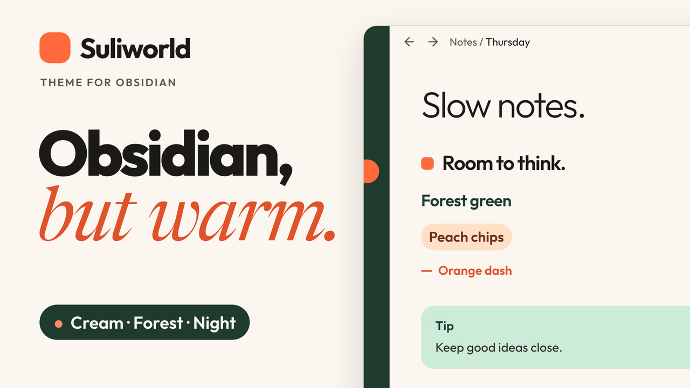

# Suliworld

A warm, editorial theme for [Obsidian](https://obsidian.md), based on the design of [suliworld.com](https://www.suliworld.com): cream paper, forest green, a touch of orange, and serif accents.

The theme draws bullet journal signifiers for your tasks. Its optional companion plugin, [Suliworld Signifiers](https://github.com/sulistef/obsidian-suliworld-signifiers), makes them interactive: a menu to pick the signifier, suggestions as you type, and more (see [Bullet journal signifiers](#bullet-journal-signifiers)).


## Features

- **Two light variants.** *Cream* (white sidebars, pill tabs) and *Forest* (deep green ribbon and sidebars, orange-underlined tabs).
- **Dark mode with floating cards.** Rounded panes float on a near-black canvas (desktop only).
- **Editorial headings.** Each level has its own look: a large light H1 over a hairline, an orange mark before H2, forest green H3, a peach chip for H4, an orange dash for H5, and small caps for H6.
- **Accent titles.** Italic text inside a heading is set in the display serif, in orange:
  `# Slow software. *Why patience ships better apps*`
- **Tinted callouts.** Note in blue, tip in mint, warning in peach, question in lavender, quote in yellow.
- **Peach blockquotes** in the display serif, **dark code blocks** in iA Writer Duo, and embedded notes shown as a dark green card.
- **Pill highlights.** `==Highlighted text==` sits in a rounded pill with room around the words, in a warm yellow (deep ochre in dark mode). A highlight that wraps gets one pill per line.
- **Folder colors.** Each folder in the file explorer gets a colored mark and a tinted guide line, automatically or by folder name (see below).
- **Bullet journal signifiers** for tasks, with symbols and colors you choose, and an optional companion plugin for a picker menu (see below).
- **Five font pairings**, all bundled: no network access is needed.
- **Mobile-friendly.** Heading sizes scale down on phones.

| Forest variant | Dark mode |
| --- | --- |
|  |  |

## Video

A 30-second tour of the theme: the warm paper, the headings, and the bullet journal signifiers you make your own.

[](https://youtu.be/PxiX_KplFyw)

## Bullet journal signifiers

The character between a task's brackets picks the symbol shown in place of the checkbox:

| Markdown | Meaning | Default symbol |
| --- | --- | --- |
| `- [ ]` | Task | • |
| `- [x]` | Done | × (struck through) |
| `- [*]` | Event | ✱ orange |
| `- [n]` | Note | ■ forest green |
| `- [>]` | Migrated | › |
| `- [<]` | Scheduled | ‹ |
| `- [!]` | Important | ! on a peach disc |

Any other character keeps Obsidian's standard checkbox. Symbols, colors, and size are set in Style Settings.

### Companion plugin: Suliworld Signifiers

The theme works on its own: it draws the signifiers, and you type the character between the brackets. The free companion plugin [Suliworld Signifiers](https://github.com/sulistef/obsidian-suliworld-signifiers) adds the interactions a theme can't provide, because themes are CSS only:

| | Theme alone | Theme + plugin |
| --- | --- | --- |
| Signifiers drawn in your notes | ✓ | ✓ (drawn by the theme, with your Style Settings) |
| Click a signifier | Toggles tasks; events and notes aren't clickable | Marks any signifier done or not done |
| Right-click or long-press | — | A menu to pick the signifier, or go back to a plain bullet |
| Typing `- [` | — | Suggests the signifiers |
| Enter at the end of an event or a note | Starts a new task | Starts a new event or note |
| Commands and hotkeys | — | Set, cycle, or remove the signifier of selected lines |

Install it from its [latest release](https://github.com/sulistef/obsidian-suliworld-signifiers/releases/latest) until it's listed in Obsidian's community plugins. The plugin also works with other themes: it then draws the signifiers itself.

## Folder colors

Folders show a small colored mark before their name, and the guide line under an open folder takes the same tint. Subfolders inherit their parent's color, a little lighter. The colors adapt to each variant: deeper on the white Cream sidebar, lighter on the Forest sidebar and in dark mode.

By default, top-level folders take the theme tints in turn: mint, lavender, orange, blue, yellow. To pick a color by folder name instead, add a CSS snippet (Settings → Appearance → CSS snippets) such as:

```css
.nav-folder:has(> .nav-folder-title:is([data-path="Projects"], [data-path="Archive"])) {
    --sw-folder-mark: "";
}

.nav-folder:has(> .nav-folder-title[data-path="Projects"]) { --sw-folder-color: var(--sw-fc-orange); }
.nav-folder:has(> .nav-folder-title[data-path="Archive"]) { --sw-folder-color: var(--sw-fc-grey); }
```

Available colors: `--sw-fc-mint`, `--sw-fc-lavender`, `--sw-fc-orange`, `--sw-fc-blue`, `--sw-fc-yellow`, `--sw-fc-forest`, `--sw-fc-grey`. Folders the snippet doesn't name keep their automatic color.

## Settings

Install the [Style Settings](https://github.com/mgmeyers/obsidian-style-settings) plugin to customize the theme:

- Font pairing for light mode and for dark mode:
  - A · Outfit × Newsreader (light default)
  - B · Manrope × Instrument Serif (dark default)
  - C · Plus Jakarta Sans × Young Serif
  - D · Hanken Grotesk × Gloock
  - E · Albert Sans × DM Mono
- Light mode variant: Cream or Forest
- Floating cards: dark mode only, always, or never
- Folder colors: automatic or off
- External link icon: ↗ arrow in the link color, none, or Obsidian's default
- Drop cap in reading view
- Plain blockquotes and plain embeds
- Bullet journal signifiers: on/off, size, and a symbol and color for each type

Without Style Settings, the theme uses the defaults listed above.

## Building from source

`theme.css` is generated. Edit `src/theme.css`, then run:

```bash
./build.sh
```

The script embeds the fonts from `fonts/` as base64, because Obsidian themes can't load font files stored next to them. To build and install into one or more vaults at once:

```bash
./build.sh ~/path/to/vault
```

## Releasing

Bump `version` in `manifest.json`, rebuild, commit, then push a tag with the same version (for example `1.0.1`). The release workflow attaches `manifest.json` and `theme.css` to a GitHub release.

## Changelog

### 1.0.2

- Renaming a file or folder in the file explorer shows a readable text field in every variant (the name was white on the field or on the yellow flash).
- With the Suliworld Signifiers companion plugin, every signifier is clickable (click to mark done, right-click or long-press for the menu). The README explains what the theme does alone and what the plugin adds.

### 1.0.1

- Highlights are rounded pills with padding around the text, in stronger colors (warm yellow in light mode, ochre in dark mode). In Live Preview, a highlight containing bold or italic text stays one pill.
- Folder colors in the file explorer: automatic by position, or set by folder name with a snippet. New Style Settings option to turn them off.

### 1.0.0

- First release.

## License

The theme is released under the [MIT License](LICENSE).

The bundled fonts are licensed under the SIL Open Font License 1.1. See [fonts/OFL.txt](fonts/OFL.txt) for their copyright notices: Outfit, Newsreader, Manrope, Instrument Serif, Plus Jakarta Sans, Young Serif, Hanken Grotesk, Gloock, Albert Sans, DM Mono, and iA Writer Duo.
